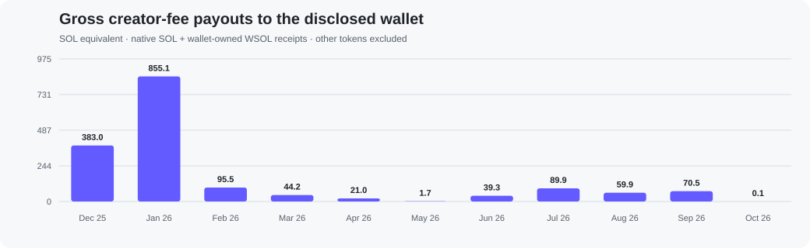
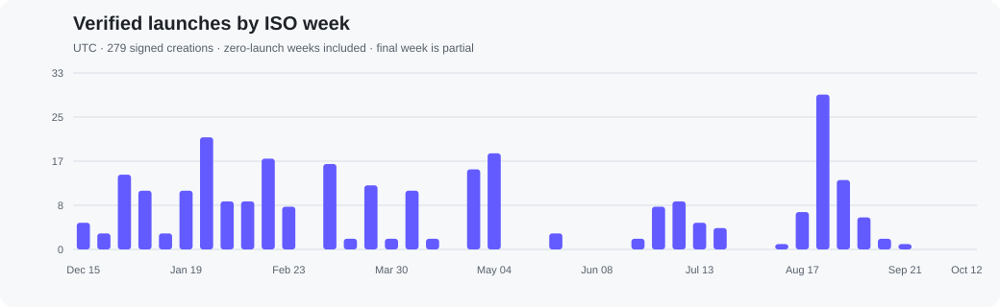

# Ramonos: Solana launches and creator-fee receipts

A reproducible, read-only study of the wallet publicly identified by [Ramonos (@ramonos)](https://x.com/ramonos/status/2097225944180424705):

```text
57rXqaQsvgyBKwebP2StfqQeCBjBS4jsrZFJN5aU2V9b
```

**279 verified launches · 1,660.2868 SOL equivalent in gross creator-fee payouts · 32,798 successful wallet transaction references.**

Ramonos's post describes the address as his wallet and says he uses multiple wallets. This repository covers that disclosed address and the fee accounts needed to reconcile its launches. It does not identify every wallet he controls. Public own-launch posts for KYOGRE, CHANCE and FREECOIN also match creation receipts signed by this address.

## The pattern

Most of the wallet's Pump launches currently assign the entire creator allocation to the disclosed wallet. Native holder rewards and developer-targeted GitHub fee routes appear in a small number of launches.

| Current Pump creator-fee destination | Launches | Share of 277 Pump launches |
|---|---:|---:|
| 100% to the disclosed launcher wallet | **263** | **94.95%** |
| Split between that wallet and other addresses | 2 | 0.72% |
| Other wallet addresses; ownership unknown | 6 | 2.17% |
| Direct GitHub account | 1 | 0.36% |
| UsePaid intermediary | 1 | 0.36% |
| Donation program | 1 | 0.36% |
| Native holder rewards | 3 | 1.08% |
| **Total Pump** | **277** | **100.00%** |

Including partial splits, **265/277 Pump launches, or 95.67%, currently allocate at least some creator fees to the disclosed wallet**. Two additional launches used Raydium LaunchLab, bringing the complete verified launch count to 279. These are launch-count percentages, not percentages of total fee value. Current settings can differ from original or historical settings.

## Money that actually reached the disclosed wallet

| Verified payout source | Receipt events | SOL / WSOL received |
|---|---:|---:|
| Pump native creator-fee claims | 368 | 319.655754211 SOL |
| PumpAMM claims to the wallet's own WSOL token account | 342 | 1,176.225105114 WSOL |
| Historical creator-fee sharing payouts | 135 | 164.405971175 SOL |
| **Gross SOL-equivalent payout total** | **845** | **1,660.286830500** |

All 568 audited fee transactions reconcile against the wallet's native cash movements, including transaction fees, other transfers, token-account funding and closing refunds. WSOL is counted once when the wallet receives it; later unwrapping does not add revenue again. Six Pump payout events denominated in other tokens are excluded from the SOL total.

**This is a gross protocol-payout receipt total, not net profit.** Direct creator vaults pool multiple mints. The whole wallet total therefore cannot be assigned exclusively to the 279 signed launches. Of the sharing payout component, 159.013155704 SOL is tagged to 15 mints in that launch cohort; 5.392815471 SOL is tagged to seven other mints. A payout instruction also does not independently prove that every vault lamport originally came from third-party trading rather than funding or released reserves.



## Trading gains and dollar value

**196 closed SOL-quote positions produced +1,674.3232 SOL in original-wallet net cash after attributable failed-transaction fees.** Their actual quote buy cost was 1,588.4392 SOL and net sale receipts were 3,314.8940 SOL. The 1,726.4548 SOL quote margin differs from net wallet cash because associated transactions also move fees, tips, reserves and other transfers.

| Measure | SOL equivalent | Historical dollar value | Same SOL at $107.60 |
|---|---:|---:|---:|
| Gross creator-fee receipts | 1,660.2868 | $199,731.89 | $178,646.86 |
| Closed-position net account cash | 1,674.3232 | $195,964.71 | $180,157.18 |
| Separate claim-transaction net account cash | 1,629.0803 | $196,532.97 | $175,289.04 |
| **Closed positions + separate claim net cash** | **3,303.4035** | **$392,497.68** | **$355,446.22** |

The last row adds the two **net cash** rows, not the gross receipt row. Standalone claim cash includes actual transaction costs, tips, account funding/refunds and outgoing transfers. In claim transactions, 30.9016 SOL went to destinations with unproved beneficial ownership or purpose; this is an actual wallet outflow, not proof of a business expense or another Ramonos wallet.

Historical values use the containing 60-second UTC Coinbase SOL/USD close for every receipt or signed cashflow. Current-value columns use the captured Coinbase last trade of **$107.60 at 2026-10-13 19:35:41 UTC**. Neither column proves that he converted the proceeds into dollars or still holds the historical SOL quantity.

**This is bounded original-wallet account cash, not complete operator net profit.** Other positions include 46 transferred-out inventories, 11 remaining inventories, 19 launches without an observed acquisition and seven closed positions in other quote assets. Across all 272 SOL-quote launches, associated cash after witnessed failed fees is +2,278.6979 SOL; with standalone claim cash it is +3,907.7782 SOL. That broader cash total includes unresolved positions and is not full realized profit. Creator claims also pool mints outside the signed-launch census.

[Detailed profit methodology](docs/profit-accounting.md) · [Per-token trades](outputs/ramonos-launches-20261013/trading/positions.csv) · [Timestamped dollar comparison](outputs/ramonos-launches-20261013/usd-valuation/comparison-metrics-usd.csv) · [Complete profit evidence release](https://github.com/twentyOne2x/ramonos-wallet-analysis/releases/tag/profit-audit-2026-10-13)

## Token-level cash results, including attributable creator fees

These are the largest **known token-attributable components of the audited wallet cash surplus**, not a complete per-token P&L ranking. Creator-claim cash is assigned only when all verified payouts in a standalone transaction identify one cohort mint and the only cash deduction is its network fee. Trading cash includes allocated failed fees once. Names and tickers link to exact mints.

| Token | Closed-position net cash, SOL | Attributable net creator claims, SOL | Known cash, SOL | Historical USD | % of SOL total |
|---|---:|---:|---:|---:|---:|
| [PsyopCartoon ($PsyCartoon)](https://pump.fun/coin/DAAXmRU9KUEuyqF8VuddbcL5X4QhQ3tTDMYxDbNgpump) | Unresolved | 157.86 | 157.86 | $22,640.25 | 4.78% |
| [just a smiling rock :) ($rock)](https://pump.fun/coin/A7CLmwzRPw2iXTGt7sGYiXsneY1ca1NS91HPaKjKpump) | 84.78 | Unallocated | 84.78 | $10,426.98 | 2.57% |
| [The Golden Pill ($PILL)](https://pump.fun/coin/3pBBa4pELb8HRneNwE9oxWTowH3hbzHkedk1f6CYpump) | 67.23 | Unallocated | 67.23 | $8,363.78 | 2.04% |
| [Igloocoin ($Igloo)](https://pump.fun/coin/8VRg5e3FW333eEfyJ81HYN1zNUP4LobtJhnu5crMpump) | 66.83 | Unallocated | 66.83 | $8,508.97 | 2.02% |
| [1M in 1HR ($1M)](https://pump.fun/coin/2uKZGdAbLoyyMiaFm8UU2atbGwpAFzpn13eEJwsypump) | 66.49 | Unallocated | 66.49 | $8,547.41 | 2.01% |
| [glitched honse ($honse)](https://pump.fun/coin/B5HLZjho2pHQQzgJWfvTPKzmmZK62YyLaNLrjrM4pump) | 58.88 | Unallocated | 58.88 | $7,327.99 | 1.78% |
| [Basket ($BASKET)](https://pump.fun/coin/3pyFv8AyuLy1FL2NDFw2fnaAzfs51ZW9wxheRVWxpump) | 58.11 | Unallocated | 58.11 | $8,428.68 | 1.76% |
| [Iced Penguin ($VVS)](https://pump.fun/coin/5Vc4nodhvRVUXdLUBRfrxCY8nBYhLM49k6qX4PMupump) | 50.79 | Unallocated | 50.79 | $6,450.26 | 1.54% |
| [Penguin's Best Friend ($Frostycko)](https://pump.fun/coin/BzJ2MxQHyc5cFhjKudB4AzFvHQNC85bbtWx1h3oopump) | 49.52 | Unallocated | 49.52 | $5,921.58 | 1.50% |
| [Mǎ Dào Chéng Gōng ($MA)](https://pump.fun/coin/BNF2swQfyMo9p1bHZQWt2WaopXiXTSSeYWPjYPQxpump) | 40.33 | Unallocated | 40.33 | $5,048.24 | 1.22% |

Percentages use the **3,303.403544339 SOL** audited cash total, not the dollar total. PsyopCartoon's row contains fee claims only because its transferred-inventory trading outcome is unresolved. "Unallocated" means pooled creator fees cannot be assigned to that token, not that it earned none. Other unresolved trading positions are excluded from this total.

Only **159.011821279 SOL** of net creator-claim cash is assignable to individual tokens. Another **1,470.068494956 SOL** remains unallocated. Therefore additional fees could change the order. Historical dollars price each included buy, sale, claim, refund and failed fee at its own transaction minute.

[Full token-attributable cash CSV](outputs/ramonos-launches-20261013/recheck-20261014/token-attributable-cash.csv) · [Independent recheck and receipts](outputs/ramonos-launches-20261013/recheck-20261014/README.md)

## Monthly activity and launch buy-in

The launches span **December 17, 2025 to September 22, 2026**; creator receipts continue through **October 10** in the October 13 audit. All monetary columns below are in SOL equivalent, grouped by individual UTC cash/receipt month.

| UTC month | Launches | All SOL trading net cash | Closed-position net cash | Gross creator fees | Median positive creation buy |
|---|---:|---:|---:|---:|---:|
| Dec 2025 | 12 | 365.230 | 237.267 | 382.968 | 17.50 |
| Jan 2026 | 56 | 1,513.922 | 1,020.606 | 855.145 | 9.23 |
| Feb | 43 | 172.181 | 120.569 | 95.537 | 2.12 |
| Mar | 30 | 66.612 | 49.648 | 44.214 | 2.12 |
| Apr | 30 | 63.525 | 63.547 | 21.032 | 5.00 |
| May | 21 | 0.959 | 0.981 | 1.741 | 3.00 |
| Jun | 8 | 50.260 | 50.202 | 39.282 | 11.79 |
| Jul | 20 | -35.808 | 35.071 | 89.896 | 8.10 |
| Aug | 43 | 66.847 | 83.062 | 59.922 | 2.00 |
| Sep | 16 | 14.968 | 13.368 | 70.475 | 3.97 |
| Oct to cutoff | 0 | 0.002 | 0.002 | 0.076 | — |
| **Total / overall median** | **279** | **2,278.698** | **1,674.323** | **1,660.287** | **4.99** |

The buy-in median uses the **230 launches with a positive SOL buy in the creation transaction**. Including 42 zero creation buys, the median across all 272 SOL launches is **3.12 SOL**. Of those zeros, 23 were first bought later and 19 have no observed acquisition. Seven non-SOL launches are excluded from the SOL median. Creation buys include venue fees; setup/network/rent costs are separate.

All-launch trading cash includes unsold/transferred inventory; closed-position cash is the narrower 196-position result. Fee payouts are gross and pooled. October's small trading amount is an account refund. December–January account for **75.13% of closed-position net cash** and **74.57% of creator receipts**.

[Monthly report](outputs/ramonos-launches-20261013/monthly/README.md) · [Full monthly CSV](outputs/ramonos-launches-20261013/monthly/monthly.csv) · [Per-launch buy-ins](outputs/ramonos-launches-20261013/monthly/per-launch-buy-in.csv)

## GitHub targeting, holder rewards and unclaimed fees

| Launch | Current fee recipient | Allocation | Claimed by the intended developer | Verified status |
|---|---|---:|---|---|
| [Flightradar24](https://pump.fun/coin/4wKXnowo19MuWeuhjfCbiVaWM1WNSkjsqWPYwymxpump) | [Flightradar24 GitHub](https://github.com/Flightradar24), numeric ID 12810712 | 100% | **0 SOL** | **0.146041920 SOL unclaimed** |
| [Bold](https://pump.fun/coin/EiDpY9QApxYMFYhR4TWXEpy6gANh73S4h3t8eSif32SM) | UsePaid; launch metadata names @boldleonidas | 100% | **Unknown** | 0.620058647 SOL generated; 0.618888685 SOL sent to UsePaid |

For Flightradar24, 0.010778206 SOL waits in its social account and 0.135263714 SOL remains in the upstream creator vault. These are proven fee lots. Initial funding and the amount freed by lower rent are excluded. Its full social-account replay and a later same-slot read both show zero native claims.

For Bold, collection by UsePaid does not establish whether the intended developer received the money. The developer's **claimed/unclaimed status remains unknown**. UsePaid's pooled lifetime counters span many other launches and are not counted as this wallet's revenue.

The three native holder-reward launches are **Diamond Hands**, **Pussy Up, Money Printer**, and **Peccy**. Native holder mode sends the creator allocation to the holder program; it is a separate mechanism from a GitHub developer claim. Holder payout performance was not audited here.

Across eight ordinary sharing routes, 59.245135418 SOL actually reached addresses other than the disclosed wallet. Their owners remain unknown; they may include additional Ramonos wallets. There is also 0.616391327 SOL equivalent of verified pending fees across separate native SOL and WSOL custody. Two small native surpluses, 240,641 lamports each, remain provenance-unknown and are excluded. Unswept curve/pool counters remain separate in the route data.

## Launch cadence

- First verified launch: **nippip**, December 17, 2025.
- Last verified launch: **VERIFIED**, September 22, 2026.
- **107 active UTC days**, averaging 2.61 launches on an active day.
- Across the 280 calendar days from first to last launch: **1.00 launch/day**.
- Peak day: **May 9, 2026 — 13 launches**.
- Peak week: **2026-W35 — 29 launches**.
- No later signed launch from this wallet appears through the audit cutoff.



## Cutoffs and coverage

| Evidence | Cutoff / observation |
|---|---|
| Launch census and own-wallet payout receipts | Before **2026-10-13 16:19:01 UTC** |
| Native creator-vault and current AMM pending replays | Before **2026-10-13 16:28:38 UTC** |
| Pump route snapshot | 2026-10-13 16:22:04–16:22:38 UTC |
| Final social-route account recheck | Finalized slot **456509511** |

The census has 34 pages and terminal provider pagination. Successful direct-wallet references are complete for the stated indexed query; wallet-owned token-account-only references were not separately enumerated. A counted launch requires an actual signed creation and matching mint initialization. Purchases, promotions and an unsigned third-party RAM creation are excluded.

Current AMM pending fees are proven from exact zero-balance checkpoints through terminal history. Earlier full-lifetime AMM token-account attempts remain explicitly partial. The different captures are not represented as a single atomic chain snapshot.

## Data and receipts

Start with:

- [All 279 launches and current destinations](outputs/ramonos-launches-20261013/ALL-LAUNCHES.csv)
- [Every native sharing recipient](outputs/ramonos-launches-20261013/FEE-RECIPIENTS.csv)
- [Every own-wallet payout event](outputs/ramonos-launches-20261013/own-fees/receipts.csv)
- [Own-wallet fee receipt report](outputs/ramonos-launches-20261013/own-fees/REPORT.md)
- [Launch and destination report](outputs/ramonos-launches-20261013/REPORT.md)
- [Independent own-fee verification](outputs/ramonos-launches-20261013/review/OWN-FEES-REPORT.md)
- [Monthly payout table](docs/monthly-creator-fees.csv)

**[Download the complete on-chain evidence pack](https://github.com/twentyOne2x/ramonos-wallet-analysis/releases/tag/audit-2026-10-13)** for the raw finalized RPC responses, exact request parameters, capture timestamps, hashes, account snapshots and replay evidence. Large raw captures are release assets so the ordinary Git checkout remains manageable. The [evidence manifest](EVIDENCE-MANIFEST.json) records every packaged member and its original hash. Public webpage sources are linked and hash-attributed rather than republishing browser UI or full web pages. Provider credentials and private adapters are excluded.

## Reproduce the calculations

Python 3.10+ and its standard library are sufficient for offline replay. Read [the tools guide](tools/README.md) for the exact command. The runner creates a separate output directory, preserving captured evidence. Its default is offline and performs no financial actions. Fresh acquisition requires a compatible read-only provider, an explicit network opt-in and a new stated cutoff; public Solana RPC does not implement every indexed-history method.

The executable checks bind event payloads to exact instructions and actual recipient movements, distinguish quote assets, validate wallet-owned WSOL receipt accounts, and reconcile cash. They use historical distribution recipients rather than projecting today's split backward.

## Reusable Codex skill

Our [**solana-launcher-audit**](skills/solana-launcher-audit/SKILL.md) skill captures the reusable workflow: identify the seed, census signed launches, classify fee destinations, reconcile actual claims and unclaimed fee lots, and report source-bound economics.

Copy `skills/solana-launcher-audit/` into `~/.codex/skills/` to install it. Example:

> Use $solana-launcher-audit to analyze this disclosed wallet's launches, creator-fee destinations and actual receipts through a fixed cutoff.

The retained scripts reproduce this Ramonos case. Auditing another wallet requires a new configuration and output directory; it does not turn the existing census into evidence for another person.

## Primary sources and reuse

- [Ramonos's wallet disclosure](https://x.com/ramonos/status/2097225944180424705) and profile-linked public Ram Calls posts.
- Finalized Solana transaction/account responses, with exact methods and parameters retained.
- Pump SDK 4.0.0 account/event schemas and [official fee-sharing documentation](https://github.com/pump-fun/pump-public-docs/blob/639b87fb45c3adeffa6f7c4a1bf0cb85e392bf22/docs/instructions/CREATOR_FEE_SHARING.md), pinned to commit `639b87fb45c3adeffa6f7c4a1bf0cb85e392bf22`.
- Official Raydium LaunchLab interface layouts, with revision and source provenance retained.

Original analysis code and derived reports are MIT licensed. Upstream schemas and sources retain their own provenance and terms; see [third-party notices](THIRD_PARTY_NOTICES.md). This repository contains the Ramonos disclosed-wallet investigation only.
